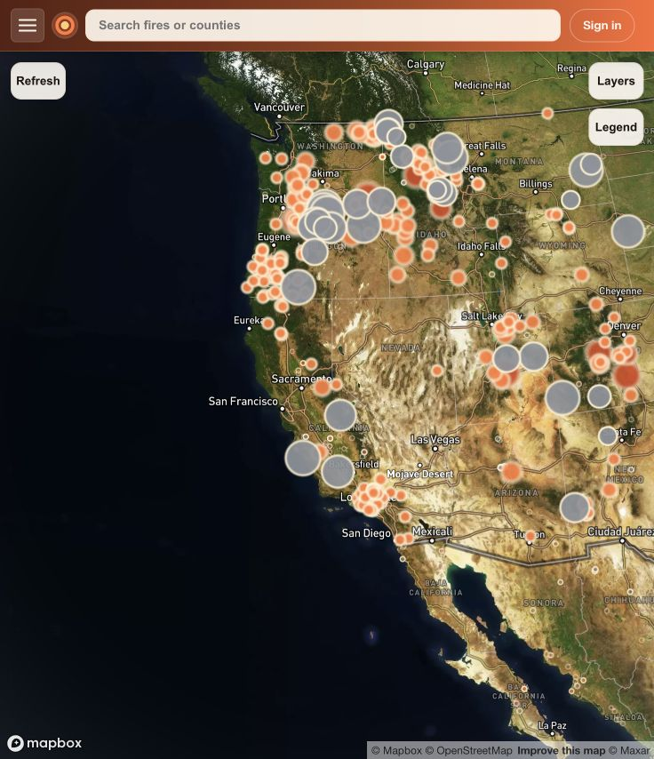

# IgnisAI

IgnisAI is a wildfire map for the western United States. It brings together active incidents, reported perimeters, satellite hotspots, and fire-weather alerts. Advisory spread forecasts are shown separately from observed fire data.

**[Open the live map](https://ignisai-frontend.onrender.com/dashboard)** · No account needed to explore.

## Try a Historical Forecast

Open **Past fires** and select **Palisades Fire**. Use the timeline to step through the advisory forecast and compare it with observed layers where available.

**For situational awareness only.** Forecasts are not official fire perimeters or evacuation guidance. Follow local authorities for emergency instructions.

This repository is a public showcase. The application source code and model weights are private.
